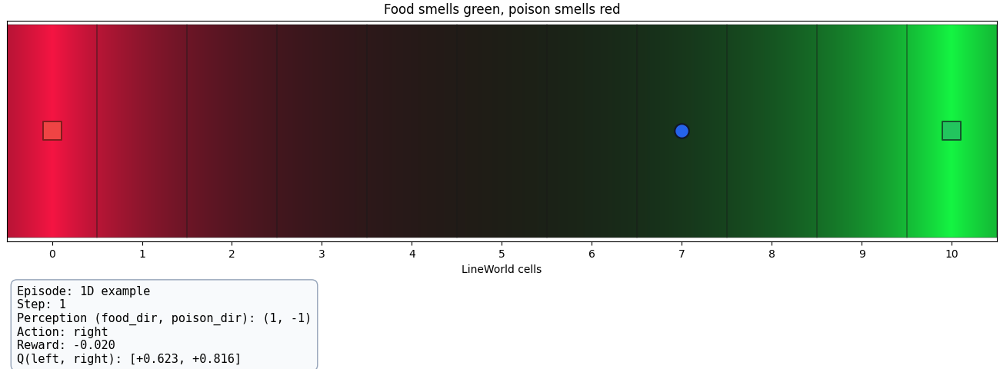
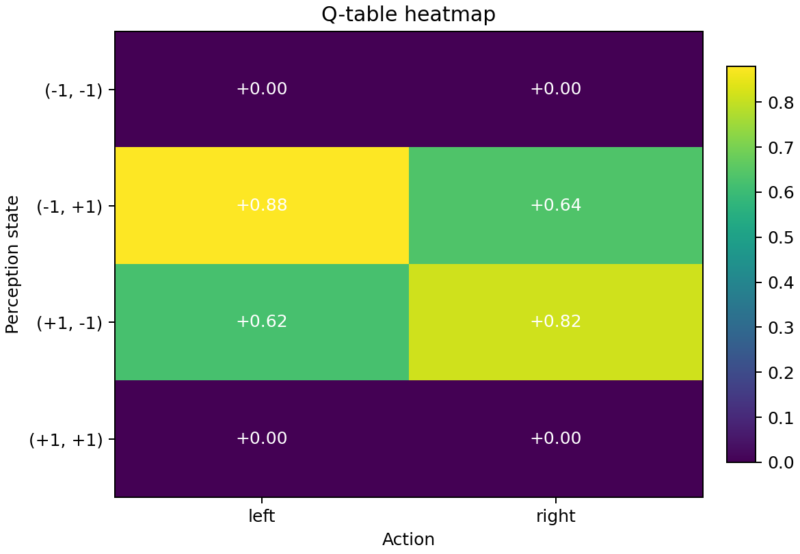
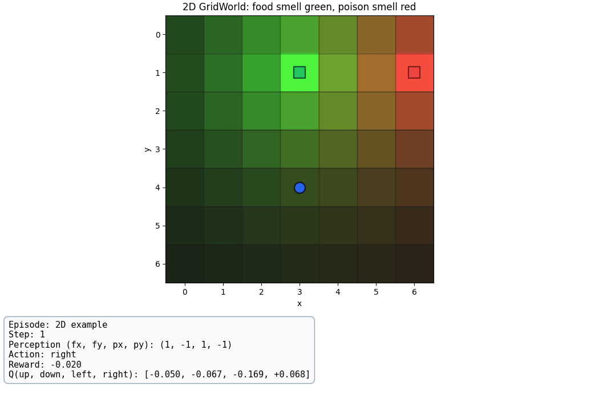
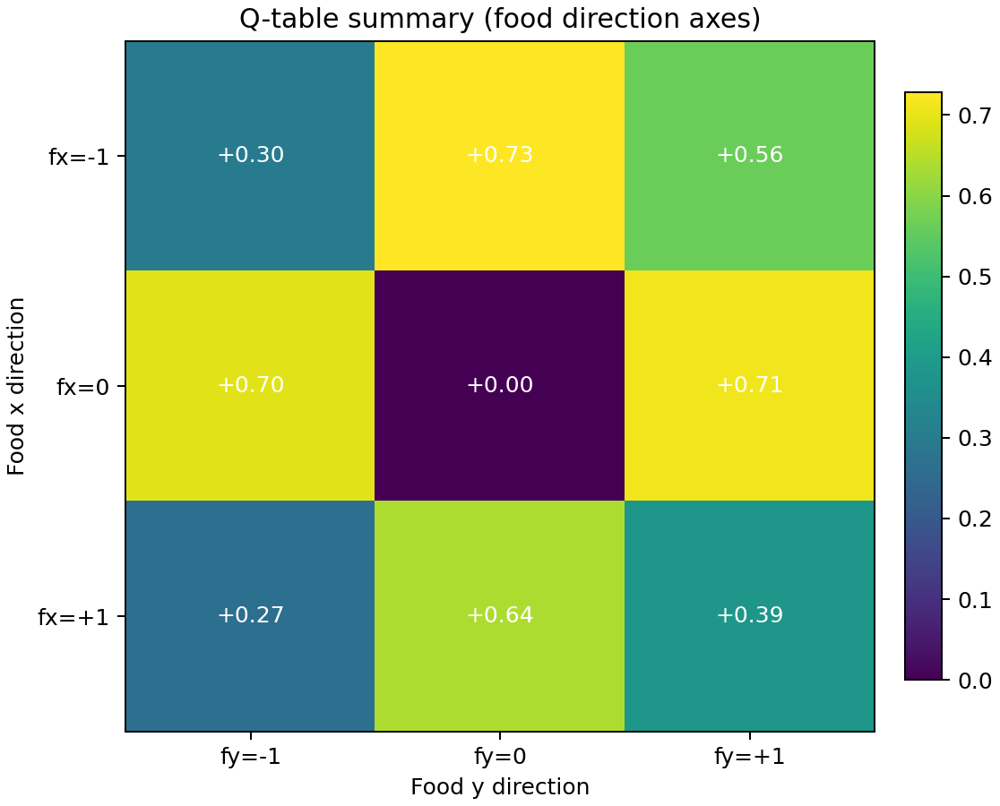

# 2dRLAnt - Experiment-Wise Project Summary

## Project Theme

This project studies a small reinforcement-learning agent that uses smell-like directional cues to find food while avoiding poison. The same learning idea is tested first in a one-dimensional world and then in a two-dimensional grid world.

The agent does not receive the complete map. Instead, it observes a compact summary of whether the food and poison smell is stronger to the left, right, up, or down. It then learns which movement action is best for each observed situation.

## Common Input and Output Intuition

- **Input:** A local, discrete perception of the environment. The observation describes the direction of the food smell and the direction of the poison smell.
- **Output:** A movement action selected by the agent.
- **Learning signal:** Positive reward for reaching food, negative reward for reaching poison, and small step costs. In 2D, bumping into a wall also adds a penalty.
- **Policy representation:** A tabular Q-function. Each table entry estimates how useful an action is for one perception state.

---

## Experiment 1 - 1D Smell-Guided LineWorld

**Directory:** `1d/`

### Goal

Test whether a small tabular Q-learning agent can use directional smell information to navigate along a line, reach food, and avoid poison when the food and poison positions are randomized between episodes.

### Input and Output Intuition

- **Input:** Two directional signals: `(food direction, poison direction)`. Each direction is either left or right.
- **Output:** Move one cell left or one cell right.
- **World:** An 11-cell line. Food and poison occupy opposite ends, and the agent starts at a random interior cell.

The agent therefore has only four possible perception states and two possible actions. It must infer that it should move toward food and away from poison, rather than memorize one fixed route.

### Methodology

- Use tabular Q-learning with a Q-table of shape `(2, 2, 2)`.
- Select actions with an epsilon-greedy policy: random exploration initially, followed by increasingly greedy action selection.
- Update Q-values with the standard temporal-difference rule using:
  - learning rate: `0.35`
  - discount factor: `0.95`
  - initial epsilon: `1.0`
  - minimum epsilon: `0.05`
  - epsilon decay: `0.995`
- Train for `1,000` episodes by default.
- Use a food reward of `+1.0`, poison reward of `-1.0`, and a per-step penalty of `-0.02`.
- Save the learned table, learning curves, Q-table heatmap, and rollout video.
- Evaluate the saved policy greedily for `100` episodes.

### Experiment Images

*Figure 1. Example 1D rollout showing the food/poison smell field, the agent position, its discretized perception, selected action, and reward.*

*Figure 2. Learned 1D Q-values for each smell-direction state and movement action.*

### Result

The stored 1D runs both achieve:

| Metric | Result |
|---|---:|
| Success rate | **1.000** |
| Average reward | **0.894** |
| Average steps | **5.300** |

The result shows that the compact smell representation is sufficient for this simple navigation task. The agent consistently reaches food instead of poison.

---

## Experiment 2 - 2D Smell-Guided GridWorld

**Directory:** `2d/`

### Goal

Extend the smell-guided navigation problem from a line to a grid. The experiment tests whether the same tabular Q-learning approach can combine horizontal and vertical directional cues while handling random food, poison, and starting positions.

### Input and Output Intuition

- **Input:** Four directional signals: `(food x direction, food y direction, poison x direction, poison y direction)`.
- **Output:** Move up, down, left, or right.
- **World:** A `7 x 7` grid. Food, poison, and the starting position are placed at different random cells at the beginning of each episode.

For example, the observation may indicate that food is generally to the right and down, while poison is to the left and up. The agent must choose one of the four movement directions using this compressed information.

### Methodology

- Use tabular Q-learning with a Q-table of shape `(3, 3, 3, 3, 4)`.
- Encode each directional component from `{-1, 0, +1}` into table indices `{0, 1, 2}`.
- Use four actions: up, down, left, and right.
- Use epsilon-greedy exploration with the same default Q-learning settings as the 1D experiment.
- Train for `1,000` episodes by default.
- Use a food reward of `+1.0`, poison reward of `-1.0`, a step penalty of `-0.02`, and a wall-bump penalty of `-0.05`.
- Limit episodes to `45` steps.
- Save the learned table, learning curves, Q-table summary heatmap, and rollout video.
- Evaluate each saved policy greedily for `100` episodes.

### Experiment Images

*Figure 3. Example 2D rollout showing the smell fields, food, poison, agent position, directional perception, selected action, and reward.*

*Figure 4. Summary of learned 2D Q-values, averaged over poison-direction components for readability.*

### Result

The valid stored 2D runs show that learning is possible but more variable than in 1D:

| Stored-run outcome | Success rate | Average reward | Average steps |
|---|---:|---:|---:|
| Lowest valid run | 0.320 | -1.376 | 30.280 |
| Best valid run | **0.700** | **-0.053** | 15.010 |
| Smoke run | 0.420 | -0.558 | 15.710 |

The best saved policy reaches food in 70% of evaluation episodes. The variation between runs indicates that the compressed directional observation is less informative in 2D: different positions can produce similar directional signals, and the agent does not directly observe distance, exact position, or the full map.

One later artifact is incompatible with the current 2D implementation: its Q-table has shape `(3, 3, 3, 3, 2, 2, 2, 2, 4)` instead of `(3, 3, 3, 3, 4)`. It is excluded from the result comparison because it belongs to a different observation representation and produces invalid actions when loaded by the current code.

---

## Comparison of Experiments

| Experiment | Environment | Observation size | Actions | Best stored success rate |
|---|---|---:|---:|---:|
| 1 | 1D LineWorld | 2 directional signals | 2 | **100%** |
| 2 | 2D GridWorld | 4 directional signals | 4 | **70%** |

## Overall Findings

- Tabular Q-learning works reliably when the smell signal and action space are simple, as shown by the 1D result.
- Moving to 2D makes the problem substantially harder even though the environment remains small.
- The 2D agent can learn useful behavior, but success varies across runs.
- Direction-only observations are compact and biologically intuitive, but they discard exact distance and location information.
- The project produces inspectable artifacts: Q-tables, learning curves, heatmaps, and rendered rollout videos.

## Limitations and Next Steps

- The current observation may alias multiple different situations into the same state.
- The 2D results should be compared using fixed seeds and repeated trials before drawing strong performance conclusions.
- A more informative observation could include smell strength, distance estimates, or the agent's position.
- The incompatible late Q-table should be regenerated or documented with the code version that created it.